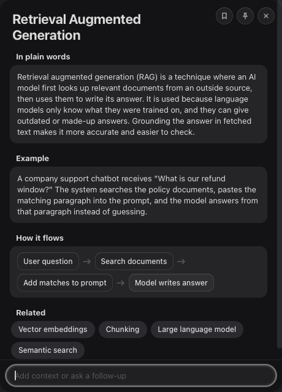

# Explain Anywhere

Select any text on your Mac, press **Control+Shift+I**, and a small floating panel explains it: what it means in plain words, a concrete example, a code snippet when the text is code, a tiny flow diagram when it is a process, and related terms you can click to explain next.

It runs on **your own Claude plan** through the [Claude Code](https://docs.claude.com/en/docs/claude-code) CLI (`claude -p`). There is no API key, no server and no third-party code: one Swift file, Apple's frameworks and a Quick Action.

<p align="center"></p>

## How it works

<p align="center"></p>

1. A macOS Quick Action receives the selected text from any app and writes it to a private temp file.
2. The app opens a non-activating panel straight away (the app you were in stays in front) and shows a loading state.
3. It runs `claude -p` with a JSON schema and no tools, MCP servers or settings, and checks the JSON it gets back.
4. The answer is drawn with text nodes only. Model output is never inserted as HTML, so nothing in it can run.
5. Optionally, each lookup is appended to a log file, saved as a note, or posted to a webhook you own.

## Requirements

- macOS 13 Ventura or later (tested on macOS 26).
- The Swift compiler from the Xcode Command Line Tools (`xcode-select --install`). No Xcode project is needed.
- [Claude Code](https://docs.claude.com/en/docs/claude-code) installed and logged in (run `claude` once). Lookups use your Claude subscription; no API key is read or stored.

## Install

```zsh
git clone https://github.com/br9704/explain-anywhere.git
cd explain-anywhere
./install.sh
```

The installer builds `~/Applications/Explain Anywhere.app`, installs the launcher at `~/.local/bin/explain-anywhere` and the Quick Action at `~/Library/Services/Explain with Claude.workflow`, writes default settings to `~/.config/explain-anywhere/config.json` and binds Control+Shift+I.

If you have an Apple Development certificate, sign with it so macOS keeps folder permissions between rebuilds:

```zsh
SIGN_ID="Apple Development: Your Name (XXXXXXXXXX)" ./install.sh
```

If the shortcut does nothing, open System Settings > Keyboard > Keyboard Shortcuts > Services > Text, tick **Explain with Claude** and set the shortcut there.

To remove it: `./uninstall.sh` (add `--all` to remove your settings too).

## Use it

- **Shortcut:** select text and press Control+Shift+I.
- **Right-click:** select text, right-click, then **Services > Explain with Claude**. macOS shows services at the top level of the menu when only a few apply, otherwise under Services.
- **Follow-ups:** type extra context or a question in the field at the bottom and press Return (or Command+Return). The answer updates in place.
- **Related terms:** click a chip to explain that term.
- **Keys:** Esc or Command+W closes, Command+C copies the answer (or your selection inside the panel).
- **Buttons:** save the answer as a Markdown note, pin the panel so it stays open, close. Drag the panel by its title; it remembers where you left it. Pinned panels stack if you look up several terms.

Motion follows the system: the panel fades, scales and unblurs in, sections rise in one after another, and the flow diagram draws itself. With **Reduce Motion** turned on, everything is a plain fade.

## Settings

`~/.config/explain-anywhere/config.json` (see `config.example.json`):

| Key | Default | What it does |
|---|---|---|
| `model` | `claude-haiku-5-5` | Model passed to `claude -p --model`. A small fast model keeps answers to a few seconds. |
| `timeoutSeconds` | `30` | Stops the CLI and shows a clear error after this many seconds. |
| `audience` | `someone learning software and AI engineering` | Who the explanation is written for. |
| `claudePath` | auto | Path to the `claude` binary if it is not in `~/.local/bin`, `/opt/homebrew/bin` or `/usr/local/bin`. |
| `logFile` | `~/Library/Logs/explain-anywhere.md` | Every lookup and follow-up is appended here as Markdown. Set to `null` to turn the log off. |
| `logKeepDays` | `14` | Older log entries are trimmed on each write. `0` keeps everything. |
| `notesDir` | `~/Documents/Explain Anywhere` | Where the save button writes one note per term (point it at an Obsidian vault if you like). |
| `webhookURL` | `null` | Optional HTTPS endpoint. Each lookup is posted once when the panel closes. |
| `webhookTokenFile` | `null` | Optional file holding a bearer token for the webhook. `EXPLAIN_WEBHOOK_TOKEN` in the environment also works. |

### Webhook payload

```json
{
  "text": "the selected text (up to 2000 characters)",
  "answer": {
    "title": "Retrieval Augmented Generation",
    "plain": "Two to four plain sentences.",
    "example": "One concrete example.",
    "code": "optional short snippet",
    "flow": ["optional", "process", "steps"],
    "related": ["optional", "related terms"]
  },
  "followups": [{ "q": "your follow-up", "a": "the plain answer to it" }],
  "source_app": "Safari"
}
```

Sent as `POST` with `Content-Type: application/json` and, when a token is set, `Authorization: Bearer <token>`. Any error is ignored, so the panel never waits on your server.

## Privacy

- The selected text, plus any follow-up you type, goes to Claude through your own Claude Code CLI, under your own account.
- Nothing else leaves your Mac unless you set `webhookURL`.
- The log and saved notes are plain local files. The webhook token is read from a file you choose and is never logged.
- The CLI runs with no tools, no MCP servers and no project settings, so a selection cannot make it read files or run commands.

## Build from source

```zsh
xcrun swiftc -O -swift-version 5 Sources/main.swift -o build/Explain -framework Cocoa -framework WebKit
./build/Explain --text "idempotency key"                 # on screen
./build/Explain --offscreen /tmp/shots --text "vector index" # headless PNG frames, then quits
```

## Credits

Built with Claude Code. Uses only Apple's AppKit, WebKit and Automator, and the Claude Code CLI by Anthropic. Not affiliated with Anthropic.

## License

[MIT](LICENSE)
