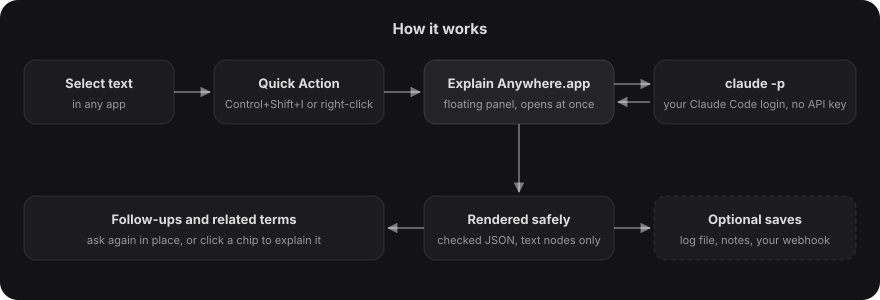

<p align="center">
  <picture>
    <source media="(prefers-color-scheme: dark)" srcset="docs/logo-dark.svg">
    
  </picture>
</p>

<h1 align="center">Explain Anywhere</h1>

<p align="center">Select any text on your Mac, press <b>Control+Shift+I</b>, and get a plain explanation from your own Claude Code.</p>

<p align="center">
  <a href="LICENSE"></a>
  
  
  <a href="https://docs.claude.com/en/docs/claude-code"></a>
  <a href="https://github.com/br9704/explain-anywhere/actions/workflows/build.yml"></a>
</p>

<p align="center"></p>

A small floating panel explains the selection: what it means in plain words, a concrete example, a code snippet when the text is code, a tiny flow diagram when it is a process, and related terms you can click to explain next.

It runs on **your own Claude plan** through the [Claude Code](https://docs.claude.com/en/docs/claude-code) CLI (`claude -p`). There is no API key, no server and no third-party code: one Swift file, Apple's frameworks and a Quick Action.

## Features

- **Works in any app** that supports macOS Services: browsers, PDF readers, editors, terminals, mail.
- **Stays out of the way.** The panel never takes focus from the app you were in, and closes on Esc or a click outside.
- **Structured answers:** plain explanation, example, optional code, optional flow diagram, related terms.
- **Follow-ups in place:** type a question or extra context and the answer updates.
- **Pin, stack and save:** pin panels to keep several open, save an answer as a Markdown note (an Obsidian vault works).
- **Safe by design:** the CLI runs with no tools and no MCP servers, and model output is drawn as text only, never as HTML.
- **Optional log and webhook** if you want a record of what you looked up.
- **Respects Reduce Motion:** with it on, every animation becomes a plain fade.

## Why not a browser extension or ChatGPT?

| | Explain Anywhere | Browser extension | Copy into a chat app |
|---|---|---|---|
| Works outside the browser (PDFs, Xcode, Terminal, Mail) | Yes | No | Yes, by hand |
| Steps per lookup | Select, one shortcut | Select, click | Copy, switch app, paste, prompt, switch back |
| Keeps you in the app you were using | Yes | Mostly | No |
| Extra subscription or API key | No, uses your Claude Code login | Often | Separate account |
| Can a selection make it run tools or read files? | No: tools and MCP are off | Depends on the extension | Depends on the app |
| Code you have to trust | One Swift file you can read | Usually a large bundle | A closed app |

If you want a long conversation, a chat app is the better tool. This is for the quick "what does this mean?" moment, without leaving what you were reading.

## Requirements

- macOS 13 Ventura or later. Tested on macOS 26 on Apple silicon; earlier versions should work but are not tested yet.
- The Swift compiler from the Xcode Command Line Tools (`xcode-select --install`). No Xcode project is needed.
- [Claude Code](https://docs.claude.com/en/docs/claude-code) installed and logged in (run `claude` once). Lookups use your Claude subscription; no API key is read or stored.

## Install

```zsh
git clone https://github.com/br9704/explain-anywhere.git
cd explain-anywhere
./install.sh
```

The installer builds `~/Applications/Explain Anywhere.app`, installs the launcher at `~/.local/bin/explain-anywhere` and the Quick Action at `~/Library/Services/Explain with Claude.workflow`, writes default settings to `~/.config/explain-anywhere/config.json` (only if that file does not exist yet) and binds Control+Shift+I.

If you have an Apple Development certificate, sign with it so macOS keeps folder permissions between rebuilds:

```zsh
SIGN_ID="Apple Development: Your Name (XXXXXXXXXX)" ./install.sh
```

**Prebuilt download.** Each [release](https://github.com/br9704/explain-anywhere/releases) has a zip with the app, the Quick Action and the installer, so you do not need the Swift compiler. The app is ad-hoc signed and **not notarized**: Gatekeeper treats it as from an unidentified developer, and the installer removes its quarantine flag so the Quick Action can open it. Only use it if you trust the download; building from source is the recommended path. Unzip, then run `./install.sh` inside the folder.

To remove it: `./uninstall.sh` (add `--all` to remove your settings too).

## Use it

- **Shortcut:** select text and press Control+Shift+I.
- **Right-click:** select text, right-click, then **Services > Explain with Claude**. macOS shows services at the top level of the menu when only a few apply, otherwise under Services.
- **Follow-ups:** type extra context or a question in the field at the bottom and press Return (or Command+Return).
- **Related terms:** click a chip to explain that term.
- **Keys:** Esc or Command+W closes, Command+C copies the answer (or your selection inside the panel).
- **Buttons:** save as a Markdown note, pin so the panel stays open, close. Drag the panel by its title; it remembers where you left it.

## How it works

<p align="center"></p>

1. A macOS Quick Action receives the selected text from any app and writes it to a private temp file (in a `0700` cache folder; the app deletes it once read).
2. The app opens a non-activating panel straight away and shows a loading state.
3. It runs `claude -p` with a JSON schema and no tools, MCP servers or settings, and validates the JSON it gets back.
4. The answer is drawn with text nodes only. Model output is never inserted as HTML, so nothing in it can run.
5. Optionally, each lookup is appended to a log file, saved as a note, or posted to a webhook you own.

## Settings

`~/.config/explain-anywhere/config.json` (see [`config.example.json`](config.example.json)):

| Key | Default | What it does |
|---|---|---|
| `model` | `claude-haiku-5-5` | Model passed to `claude -p --model`. A small fast model keeps answers to a few seconds. |
| `timeoutSeconds` | `30` | Stops the CLI and shows a clear error after this many seconds. |
| `audience` | `someone learning software and AI engineering` | Who the explanation is written for. |
| `claudePath` | auto | Path to the `claude` binary if it is not in `~/.local/bin`, `/opt/homebrew/bin` or `/usr/local/bin`. |
| `logFile` | `~/Library/Logs/explain-anywhere.md` | Every lookup and follow-up is appended here as Markdown. Set to `null` to turn the log off. |
| `logKeepDays` | `14` | Older log entries are trimmed on each write. `0` keeps everything. |
| `notesDir` | `~/Documents/Explain Anywhere` | Where the save button writes one note per term. |
| `webhookURL` | `null` | Optional HTTPS endpoint. Each lookup is posted once when the panel closes. |
| `webhookTokenFile` | `null` | Optional file holding a bearer token for the webhook. `EXPLAIN_WEBHOOK_TOKEN` in the environment also works. |

<details>
<summary>Webhook payload</summary>

```json
{
  "text": "the selected text (up to 2000 characters)",
  "answer": {
    "title": "Retrieval Augmented Generation",
    "plain": "Two to four plain sentences.",
    "example": "One concrete example.",
    "code": "optional short snippet",
    "flow": ["optional", "process", "steps"],
    "related": ["optional", "related terms"]
  },
  "followups": [{ "q": "your follow-up", "a": "the plain answer to it" }],
  "source_app": "Safari"
}
```

Sent as `POST` with `Content-Type: application/json` and, when a token is set, `Authorization: Bearer <token>`. Any error is ignored, so the panel never waits on your server.
</details>

## Privacy

- The selected text, plus any follow-up you type, goes to Claude through your own Claude Code CLI, under your own account.
- Nothing else leaves your Mac unless you set `webhookURL`.
- The log and saved notes are plain local files. The webhook token is read from a file you choose and is never logged.
- The CLI runs with no tools, no MCP servers and no project settings, so a selection cannot make it read files or run commands.

See [SECURITY.md](SECURITY.md) for the threat model.

## FAQ

**Does it need an API key?** No. It calls the Claude Code CLI you already use, so lookups count against your Claude plan.

**Which model does it use?** Whatever `model` says in the config. The default is a small, fast model so answers take a few seconds.

**Can I use it without Claude Code?** Not today. The app is a thin, safe front end for `claude -p`.

**Does it see my screen or clipboard?** No. It only receives the text macOS hands to the Quick Action when you invoke it.

**Why one Swift file and no Xcode project?** So you can read all of it before you run it, and build it with a single `swiftc` command.

## Troubleshooting

**The shortcut does nothing.** Open System Settings > Keyboard > Keyboard Shortcuts > Services > Text, tick **Explain with Claude** and set the shortcut there. Some apps claim Control+Shift+I for themselves; pick another shortcut in the same place, or use right-click > Services. The app you select text in must support Services (most native and browser text does).

**macOS keeps asking for access to Documents or Desktop.** The save button writes to `notesDir`, which macOS protects when it is inside Documents or Desktop. An ad-hoc signed build gets a new identity on every rebuild, so macOS forgets the grant. Sign with your own certificate (`SIGN_ID=... ./install.sh`), or point `notesDir` at a folder outside Documents and Desktop. To clear a stuck prompt: `tccutil reset All io.github.explain-anywhere`.

**"Claude Code is not logged in" or "did not answer".** Run `claude` in Terminal once and finish the login. If `claude` lives somewhere unusual, set `claudePath` in the config. Check the CLI on its own with `claude -p "hello"`.

**Answers are slow or time out.** Keep the default small model and shorter selections, or raise `timeoutSeconds`.

## Build from source

```zsh
xcrun swiftc -O -swift-version 5 Sources/main.swift -o build/Explain -framework Cocoa -framework WebKit
./build/Explain --text "idempotency key"                         # on screen
./build/Explain --offscreen /tmp/shots --text "vector index"     # headless PNG frames, then quits
./build/Explain --offscreen /tmp/frames --frames 30 --text "RAG" # numbered frames for the demo GIF
scripts/build-app.sh "build/Explain Anywhere.app"                # the full app bundle, ad-hoc signed
scripts/package-release.sh                                       # the release zip
```

## What is tested

Honest status for v0.1.0:

- Built and run on macOS 26 (Apple silicon) with Claude Code logged in to a Claude subscription.
- CI compiles `Sources/main.swift` on a GitHub macOS runner and runs ShellCheck on the scripts on every push.
- There are no automated UI tests yet. The `--offscreen` mode renders the real panel headlessly with a real answer; the screenshots and the demo above come from it.
- Not yet tested: macOS 13 to 15, Intel Macs, and Services support in every app.

## Roadmap

- A settings window instead of editing JSON.
- A signed and notarized release build.
- Streaming, so long answers appear as they arrive.
- A light appearance for the panel.
- Explanations in more languages.

Ideas are welcome in [issues](https://github.com/br9704/explain-anywhere/issues).

## Contributing

Bug reports, fixes and small focused features are welcome. Read [CONTRIBUTING.md](CONTRIBUTING.md) first; the project keeps to one Swift file, Apple frameworks only, and no third-party dependencies. Everyone taking part follows the [Code of Conduct](CODE_OF_CONDUCT.md).

## Credits

Built with Claude Code. Uses only Apple's AppKit, WebKit and Automator, and the Claude Code CLI by Anthropic. Not affiliated with Anthropic.

## License

[MIT](LICENSE)
